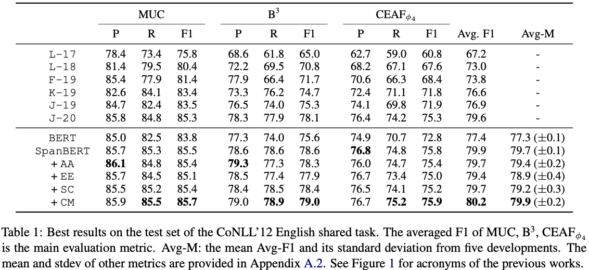

# Results

## Tables

Create a table displaying experimental results from your [models](/chapters/experiments/models) on each [dataset](/chapters/experiments/datasets) and evaluation metric. The table should also include results from previous work directly comparable to yours.

:::info
If the table is too large (e.g., taking more than 1/3 of the page), it may overwhelm the readers. In this case, shrink it by including only the critical results and put the rest in the appendix.
:::

Here are a few tips for creating the result table:

* Expand it to the full page if it consists of many columns.
* Use acronyms for the header titles if too long, and explain them in the caption.
* If space allows, include both the average scores and standard deviations. The standard deviation is usually notated by the plus-minus sign (e.g., $$\pm 0.1$$).
* Highlight the key results by making them bold.
* State the unit of every score (e.g., %) in the caption or header, and mark whether higher or lower is better (e.g., ↑ for accuracy, ↓ for error).
* Clearly mark results taken from previous work, as opposed to those you reproduced yourself.

:::info
Sometimes, it makes more sense to use multiple tables to present your results (e.g., working on multiple tasks), in which case, use a consistent scheme across the tables so they can be easily compared.
:::

## Significance

Reporting the average and standard deviation shows how stable each model is, but it does not tell whether one model is truly better than another. When the gap between two models is small relative to the standard deviation, run a statistical significance test (e.g., a paired bootstrap test or a paired $$t$$-test over the multiple runs) and report the $$p$$-value:

> The improvement of ADVANCED over BASELINE is statistically significant ($$p < 0.05$$).

:::info
Do not claim that a model is better only because its score is higher by a small margin. Without a significance test, describe such differences as comparable.
:::

## Ablation Study

If your best model combines several methods, show how much each method contributes by removing (or adding) one at a time and reporting the results in a separate table:

> Removing METHOD 1 from BEST drops the F1-score by #.#%, whereas removing METHOD 2 has little effect, suggesting that METHOD 1 is the key contributor.

:::info
The incremental design in the [Models](/chapters/experiments/models) section (BASELINE → ADVANCED → BEST) already serves as a simple ablation. A separate table is needed when the methods are not strictly incremental.
:::

## Interpretations

Once the result table is presented, you need to give an interpretation of the results. First, summarize the overall observations:

> Each model shows an incremental improvement over its predecessor.
>
> MODEL 2 shows a noticeable improvement over MODEL 1, indicating the effectiveness of our METHOD.
>
> The ADVANCED MODEL shows a significant improvement of #.#% from the BASELINE MODEL.

Then, describe any key findings:

> It is interesting that MODEL 2 shows better performance over MODEL 1 on DATASET 1 but the results are opposite on DATASET 2.

Give an interpretation for each key finding (and indicate a specific subsection in the [Analysis](/chapters/analysis/performance-analysis) section where further analysis is provided):

> It is likely because METHOD works well for ASPECTS in DATASET 1, but not necessarily for ASPECTS in DATASET 2 (Section #.#).

:::info
In general, high-level interpretations are provided in the Experiments section whereas more detailed analyses are provided in the Analysis section. These two sections, however, can be merged into one if the space is limited.
:::

Finally, explain any additional results that are not included in the table but help readers interpret this work better:

> It is worth mentioning that we also experimented with METHOD 1, which showed a similar result as METHOD 2.

:::info
The interpretation should not be simply reading the table. The main goal of this interpretation is to provide insights that are not so obvious to the readers by reading the table, but that you learned during this study.
:::
